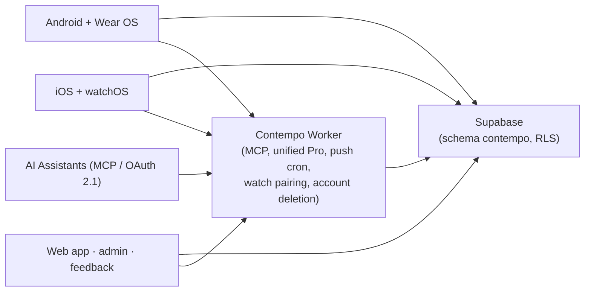

## How it fits together

Each user's entries, properties, attachments and captures are their own rows (row-level
security) and files (`<uid>/…` in a private bucket). Pro unlocks across iPhone, Android, Web, and
MCP from a single account (App Store, Google Play, Stripe, or an email grant). Details: `projects/contempo/CLAUDE.md`.
