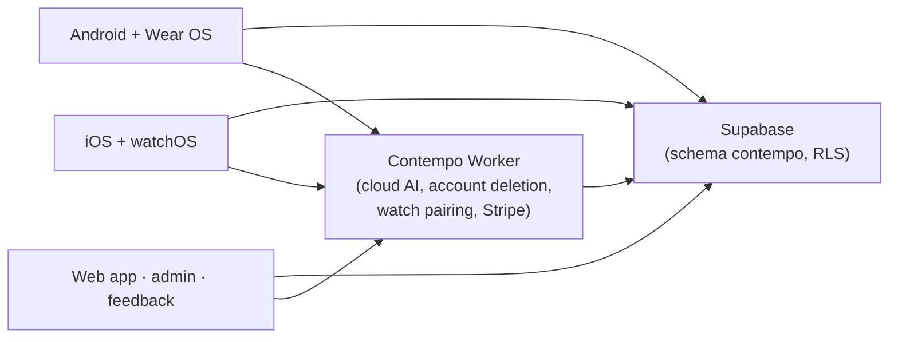

## How it fits together

Each user's entries, properties, attachments and captures are their own rows (row-level
security) and files (`<uid>/…` in a private bucket). Details: `projects/contempo/CLAUDE.md`.
