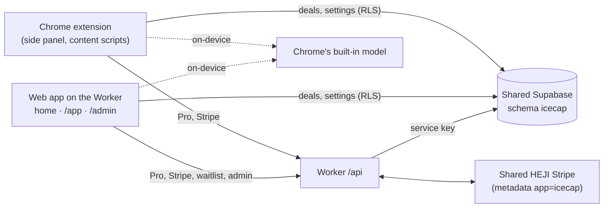

## How it fits together

- **Extension** (`apps/extension`): Manifest V3, built with Vite. Content scripts read the listing and
  badge map pins; the side panel does the math (`@icecap/math`), saves deals and runs the AI.
- **Web app and API** (`services/web`): one Cloudflare Worker serves the home page and waitlist, the
  dashboard (`/app/`), admin (`/admin/`), privacy and terms, the promo studio, and `/api`.
- **Pro**: a yearly plan with a free week, or lifetime, through the HEJI Stripe account; or given by
  email. The extension and the co-pilot need it.

More: [Decisions](./decisions) · [Deployment](./DEPLOY) · the project's
[README](https://github.com/tianhaoz95/hejitech-apps/tree/main/projects/icecap).
