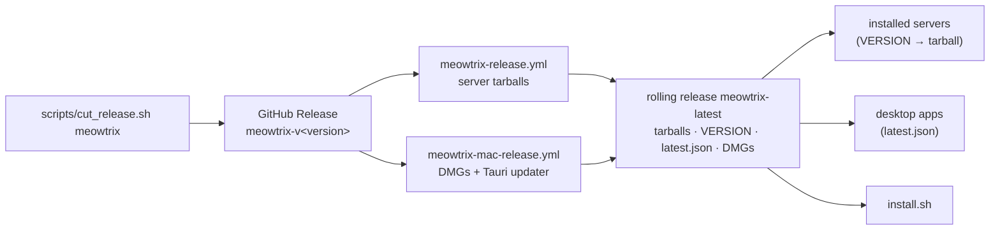

## Install

```sh
curl -fsSL https://raw.githubusercontent.com/tianhaoz95/hejitech-apps/main/projects/meowtrix/install.sh | bash
```

Add `-s -- --service` to run it as a login service, or download the macOS app:
[Standalone](https://github.com/tianhaoz95/hejitech-apps/releases/download/meowtrix-latest/Meowtrix-Standalone-arm64.dmg) ·
[Lite](https://github.com/tianhaoz95/hejitech-apps/releases/download/meowtrix-latest/Meowtrix-Lite-arm64.dmg).

## How releases reach users



The monorepo's `releases/latest` belongs to another app, so everything that used it reads the
rolling `meowtrix-latest` release instead. Working on Meowtrix: `projects/meowtrix/CLAUDE.md`.
