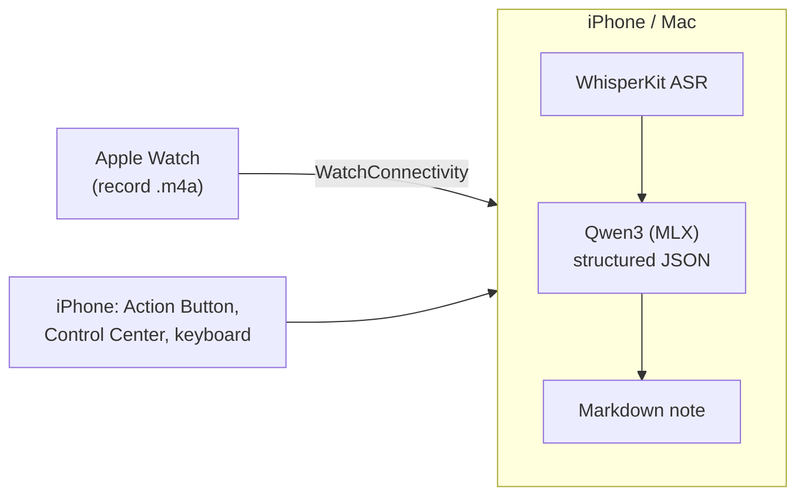

## How it fits together

## Working on it

Everything is in [`projects/voxbrief`](https://github.com/tianhaoz95/hejitech-apps/tree/main/projects/voxbrief):
an XcodeGen project (`project.yml`) with the iOS app, watch app, widgets, keyboard extension and
the Mac app. Its `CLAUDE.md` has the commands, architecture and the rules that matter (MLX never
runs in the Simulator; every change goes into the in-app What's New).

Releases: `scripts/cut_release.sh voxbrief` from the repo root publishes `voxbrief-v<version>`,
which uploads the iPhone build to TestFlight and attaches a notarized Mac DMG to the release.
