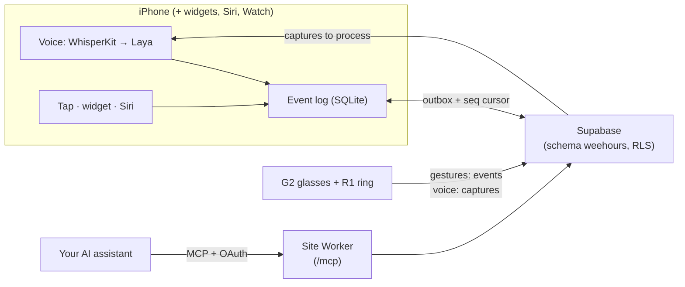

## What's next, in one line

Every surface shows the same status, derived from the log by the same fixture-locked code in Swift
and TypeScript:

```
Fed 2h40m ago · left next · diaper 1h10m ago
```

## How it fits together



- **Local first.** "Use without an account" keeps the household on the phone; signing in later
  uploads it, as a new household or into your partner's.
- **The glasses never run a model.** Gestures write events directly; hold-to-speak uploads a
  capture that a household phone processes later, and two phones converge on the same result.
- **One spec.** `spec/` holds the event types, decision questions, calibration and fixtures that
  the Swift and TypeScript implementations both must pass.

The full design, eval numbers and screenshots are in the
[v0 design walkthrough](https://tianhaoz95.github.io/hejitech-apps/weehours/report/index.html).
Code: [`projects/weehours`](https://github.com/tianhaoz95/hejitech-apps/tree/main/projects/weehours).
